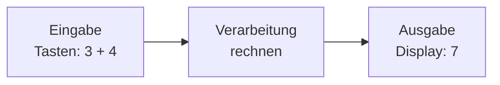

# Das EVA-Prinzip

Ein Taschenrechner, ein Smartphone und eine Ampelanlage haben auf den ersten Blick nichts gemeinsam. Und doch tun alle drei im Kern dasselbe. Was?

## Eingabe – Verarbeitung – Ausgabe

Denk an den Taschenrechner: Du tippst `3 + 4` ein, er rechnet, und auf dem Display erscheint `7`.

:::snippet{#merken}
Jedes Informatiksystem arbeitet nach dem :t[EVA-Prinzip]{#eva-prinzip}:

- **E**ingabe: Daten gelangen in das System – über Tasten, Maus, Mikrofon, Kamera, Sensoren oder das Netzwerk.
- **V**erarbeitung: Das System verarbeitet die Daten nach festen Regeln – mit einem Programm.
- **A**usgabe: Das Ergebnis verlässt das System – über Bildschirm, Lautsprecher, Drucker, Motoren oder das Netzwerk.

Oft kommt ein vierter Teil dazu: Daten werden **gespeichert**, damit sie später wieder zur Verfügung stehen.
:::

:::snippet{#beispiel}
**Smartphone-Kamera:** Der Bildsensor nimmt Licht auf (Eingabe). Der Prozessor berechnet daraus ein Foto, schärft es nach und verkleinert es (Verarbeitung). Das Foto erscheint auf dem Bildschirm (Ausgabe) und landet im Speicher (Speicherung).
:::

## Was gehört wohin?

:::snippet{#aufgabe}
Ordne jedem Gerät zu, was dort **verarbeitet** wird. Ziehe dazu eine Linie vom blauen Punkt zum passenden orangen Punkt.
:::

<card-matching
  id="rechner-eva-zuordnen"
  pairs='[
    {"blue": "text:Navi: GPS-Signal kommt an", "orange": "text:Position auf der Karte berechnen"},
    {"blue": "text:Spielkonsole: Taste am Controller", "orange": "text:Figur im Spiel bewegen"},
    {"blue": "text:Ampel: Sensor meldet Fußgänger", "orange": "text:Zeitpunkt für Grün berechnen"},
    {"blue": "text:Sprachassistent: Mikrofon hört Frage", "orange": "text:Sprache in Text umwandeln und Antwort suchen"}
  ]'>
</card-matching>

:::snippet{#aufgabe}
Wähle **drei Geräte** aus deinem Alltag, die nicht auf dieser Seite vorkommen. Zeichne für jedes Gerät eine EVA-Kette in das Zeichenfeld unten:

1. **Fotografiere** jedes Gerät mit deinem Smartphone oder dem Tablet. Ziehe das Foto in den gestrichelten Rahmen „Foto“ (oder: Werkzeugleiste → Bild einfügen) und verkleinere es, bis es hineinpasst.
2. Ersetze „Gerät 1: …“ durch den Namen des Geräts.
3. Doppelklicke in jeden Kasten und schreibe hinein, was dort passiert.
4. Wenn das Gerät auch etwas **speichert**, ergänze einen vierten Kasten „Speicherung“.

Speichere deine Zeichnung am Ende: **Menü (☰ oben links) → „Export image…“ → PNG**. Das Foto wird mit exportiert. Gib das Bild so ab, wie es deine Lehrkraft sagt.
:::

:::alert{info}
Nimm am besten **eigene Fotos**. Ein Bild aus dem Internet darfst du nur verwenden, wenn seine Lizenz das erlaubt – und dann nennst du die Quelle. Achte darauf, dass auf deinen Fotos **keine Personen** zu erkennen sind.
:::

:::alert{warn}
Das Zeichenfeld merkt sich deine Zeichnung **nicht**. Wenn du die Seite neu lädst oder verlässt, ist sie weg. Exportiere sie also, bevor du weitergehst.
:::

::excalidraw{src="./01-eva-vorlage.excalidraw" edit=true autoZoom=true aspectRatio="4/3"}

::::collapsible{title="Tipp 1: Welche Geräte?"}

Am einfachsten sind Geräte, die du gerade fotografieren kannst – im Klassenraum, in der Schule oder zu Hause. Denk an Geräte mit Strom und mit einem Display, einem Lautsprecher oder einem Motor: Fitnessuhr, Kaffeeautomat, Fahrkartenautomat, Kassenscanner im Supermarkt, Saugroboter …

::::

::::collapsible{title="Tipp 2: Wie finde ich die Verarbeitung?"}

Frage dich: Was macht das Gerät **aus** der Eingabe? Die Verarbeitung ist das, was zwischen „etwas kommt herein“ und „etwas kommt heraus“ passiert – meist ein Rechnen, Vergleichen oder Umwandeln.

::::

:::protect{password="rechner-1-1-1" description="Lösung. Erfrage das Passwort bei deiner Lehrkraft."}

Beispiele:

| Gerät | Eingabe | Verarbeitung | Ausgabe |
| --- | --- | --- | --- |
| Fitnessuhr | Pulssensor, Bewegungssensor | Schritte zählen, Puls auswerten | Anzeige der Schritte, Vibration |
| Fahrkartenautomat | Touchscreen, Münzen, Karte | Preis berechnen, Zahlung prüfen | Fahrkarte, Wechselgeld |
| Saugroboter | Abstandssensoren, Kamera | Weg planen, Hindernisse umfahren | Motoren für Räder und Bürsten |

:::

:::snippet{#brain}
Bei einer Ampel mit Fußgängertaste ist die Ausgabe der einen Ampel (Grün für Autos endet) gleichzeitig eine Information für die Fußgängerampel. Viele Systeme bestehen aus mehreren EVA-Systemen, deren Ausgaben die Eingaben anderer sind. Findest du ein weiteres Beispiel?
:::

---

## Selbsttest

::::multievent

**1. Wofür steht EVA?**
{r1{!Eingabe – Verarbeitung – Ausgabe}}
{r1{Elektronische Verarbeitungsanlage}}
{r1{Eingabe – Vergleich – Abspeicherung}}
{H{Richtig.}}

**2. Ein Mikrofon ist ein Gerät für die …**
{r2{!Eingabe}}
{r2{Verarbeitung}}
{r2{Ausgabe}}
{H{Richtig. Es nimmt Schall auf und bringt ihn als Daten in das System.}}

**3. Ordne zu.**

Lautsprecher: {S1{Ausgabe}}

Tastatur: {S1{Eingabe}}

Prozessor: {S1{Verarbeitung}}

{H{Richtig.}}
{h{Frage dich: Kommt hier etwas herein, wird etwas berechnet oder geht etwas hinaus?}}

**4. Welche Aussage stimmt?**
{r4{!Auch eine Waschmaschine mit Programmwahl arbeitet nach dem EVA-Prinzip.}}
{r4{Nur Geräte mit Bildschirm arbeiten nach dem EVA-Prinzip.}}
{H{Richtig. Programmwahl und Sensoren sind die Eingabe, Motor und Pumpe die Ausgabe.}}

**5. Ein Touchscreen ist …**
{r5{!Eingabe- und Ausgabegerät zugleich}}
{r5{nur ein Ausgabegerät}}
{H{Richtig. Er zeigt an und nimmt Berührungen auf.}}

::::
