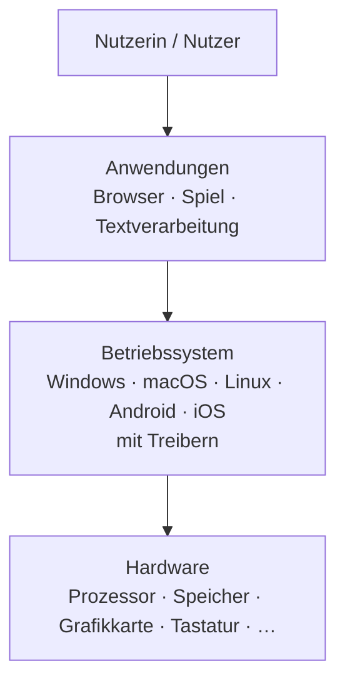

# Hardware, Betriebssystem, Anwendung

Dasselbe Spiel läuft auf Computern mit ganz unterschiedlichen Grafikkarten, Prozessoren und Festplatten. Woher weiß das Spiel, wie es mit genau deiner Hardware sprechen muss? Gar nicht – das übernimmt jemand anderes.

## Drei Schichten

:::snippet{#merken}
Software baut in **Schichten** auf der Hardware auf:

- Die **Hardware** führt nur einfache Befehle aus: Bitmuster laden, addieren, speichern.
- Das :t[Betriebssystem]{#betriebssystem} verwaltet die Hardware: Es verteilt Prozessorzeit und Arbeitsspeicher auf die Programme, organisiert Dateien und spricht über **Treiber** mit den Geräten.
- **Anwendungen** erledigen Aufgaben für dich. Sie greifen nicht direkt auf die Hardware zu, sondern bitten das Betriebssystem darum.

Jede Schicht nutzt nur die Schicht direkt darunter. Deshalb läuft ein Spiel auf vielen verschiedenen Rechnern – solange es dasselbe Betriebssystem gibt.
:::

:::snippet{#beispiel}
**Du speicherst ein Referat.** Die Textverarbeitung sagt dem Betriebssystem: „Speichere diese Daten unter `Referat.odt`.“ Das Betriebssystem sucht freien Platz auf der SSD, merkt sich, wo die Datei liegt, und schickt die Daten über den Treiber an die SSD. Die Textverarbeitung muss nicht wissen, welche SSD eingebaut ist.
:::

:::snippet{#aufgabe}
Ordne jeder Aufgabe zu, welche Schicht sie erledigt.
:::

<card-matching
  id="rechner-schichten-zuordnen"
  pairs='[
    {"blue": "text:Rechtschreibfehler rot unterstreichen", "orange": "text:Anwendung"},
    {"blue": "text:entscheiden, welches Programm gerade den Prozessor nutzen darf", "orange": "text:Betriebssystem"},
    {"blue": "text:zwei Bitmuster addieren", "orange": "text:Hardware"},
    {"blue": "text:dem Drucker die Seite in seiner Sprache schicken", "orange": "text:Treiber"}
  ]'>
</card-matching>

## Was passiert beim Einschalten?

:::snippet{#aufgabe}
Bringe die Schritte beim Einschalten eines Computers in die richtige Reihenfolge. Nutze dazu den Selbsttest unten (Frage 4) – überlege aber zuerst selbst und notiere deine Reihenfolge.

- Das Betriebssystem wird von der SSD in den Arbeitsspeicher geladen.
- Du meldest dich an und startest den Browser.
- Ein kleines Programm auf der Hauptplatine (die **Firmware**, früher BIOS genannt) prüft die Hardware.
- Das Netzteil versorgt die Bauteile mit Strom.
- Das Betriebssystem startet die Treiber und zeigt den Anmeldebildschirm.
:::

::textinput{id="rechner-schichten-start" placeholder="1. … 2. … 3. … 4. … 5. …" height="100px"}

::::collapsible{title="Tipp: Wo liegt das Betriebssystem, bevor der Rechner läuft?"}

Das Betriebssystem liegt auf der SSD. Damit es überhaupt geladen werden kann, muss vorher schon *irgendein* Programm laufen. Dieses Programm darf deshalb nicht auf der SSD liegen.

::::

:::protect{password="rechner-4-1-1" description="Lösung. Erfrage das Passwort bei deiner Lehrkraft."}

1. Das Netzteil versorgt die Bauteile mit Strom.
2. Die Firmware auf der Hauptplatine prüft die Hardware und sucht ein Startlaufwerk.
3. Das Betriebssystem wird von der SSD in den Arbeitsspeicher geladen.
4. Das Betriebssystem startet die Treiber und zeigt den Anmeldebildschirm.
5. Du meldest dich an und startest den Browser.

Die Firmware ist fest auf einem Speicherchip der Hauptplatine gespeichert. Sie ist die einzige Software, die schon beim Einschalten bereitsteht.

:::

:::snippet{#brain}
Programme wie ein Spiel gibt es oft getrennt für Windows, macOS und Android. Warum muss ein Spiel für jedes Betriebssystem eigens angepasst werden, obwohl die Hardware ganz ähnlich sein kann?
:::

---

## Selbsttest

::::multievent

**1. Welche Schicht spricht direkt mit der Hardware?**
{r1{!das Betriebssystem mit seinen Treibern}}
{r1{der Browser}}
{r1{die Nutzerin}}
{H{Richtig.}}

**2. Wozu dient ein Treiber?**
{r2{!Er übersetzt zwischen Betriebssystem und einem bestimmten Gerät.}}
{r2{Er treibt den Lüfter an.}}
{H{Richtig.}}

**3. Welches ist kein Betriebssystem?**
{r3{!Firefox}}
{r3{Linux}}
{r3{Android}}
{H{Richtig. Firefox ist ein Browser, also eine Anwendung.}}

**4. Bringe die Schritte beim Einschalten in die richtige Reihenfolge.**

{S4{Strom vom Netzteil}}

{S4{Firmware prüft die Hardware}}

{S4{Betriebssystem wird geladen}}

{S4{Anmeldebildschirm erscheint}}

{S4{Browser wird gestartet}}

{H{Richtig.}}

**5. Was verteilt das Betriebssystem auf die laufenden Programme?**
{c5{!Prozessorzeit}}
{c5{!Arbeitsspeicher}}
{c5{Strom aus der Steckdose}}
{H{Richtig.}}

::::
