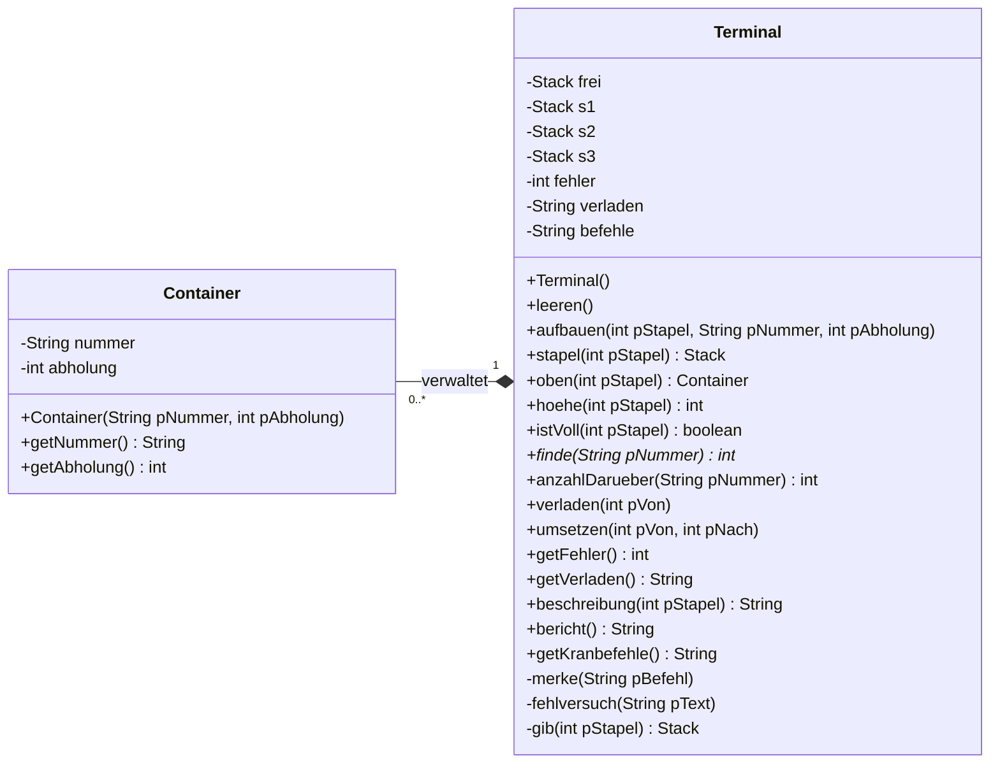
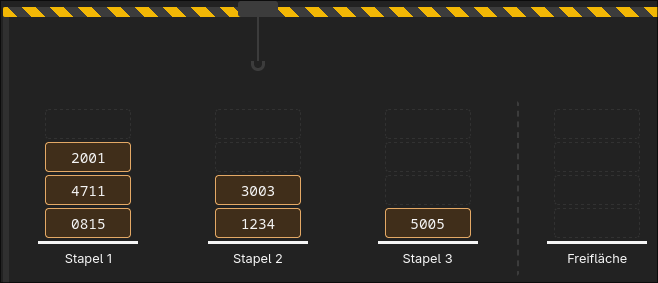

# Containerterminal: Der Kran


<small>Foto: Hozro, „Hafen Wörth, Kran Containerterminal (2)“, CC0 1.0, über [Wikimedia Commons](https://commons.wikimedia.org/wiki/File:Hafen_W%C3%B6rth,_Kran_Containerterminal_%282%29.jpg)</small>

Im Hafen stehen die Container in Stapeln. Der Portalkran fährt über die Stapel und greift einen Container immer **von oben** – an einen Container weiter unten kommt er nicht heran. Jeder Containerstapel ist also ein Stapel im Sinne der Informatik.

In diesem Kapitel baust du ein Terminal mit drei Stapeln und einer Freifläche in Java nach. Auf dieser Seite programmierst du den Kran selbst; auf den folgenden Seiten benutzt du ihn, um möglichst geschickt Container auf Lkw zu verladen.

## Das Terminal in Java



:::snippet{#merken}
**Die Klasse `Terminal`**

Das Terminal hat drei Stapel und eine Freifläche – jeweils ein Objekt der Abiturklasse `Stack<Container>`. Sie werden über eine Nummer angesprochen: **1, 2, 3** sind die Stapel, **0** ist die Freifläche. Die Stapel 1 bis 3 tragen höchstens **vier** Container, auf die Freifläche passt beliebig viel.

| Methode | Was sie tut |
| --- | --- |
| `Container oben(int pStapel)` | der oberste Container oder `null` |
| `int hoehe(int pStapel)` | Anzahl der Container auf dem Stapel |
| `boolean istVoll(int pStapel)` | Stehen schon vier Container auf dem Stapel? Die Freifläche ist nie voll. |
| `Stack<Container> stapel(int pStapel)` | eine **Kopie** des Stapels zum Nachsehen |
| `void verladen(int pVon)` | verlädt den obersten Container auf einen Lkw |
| `void umsetzen(int pVon, int pNach)` | setzt den obersten Container auf einen anderen Stapel – **Aufgabe 2** |
| `int finde(String pNummer)` | Stapel, in dem der Container steht: 1 bis 3, 0 = Freifläche, -1 = nicht im Terminal – **Aufgabe 3** |

Ein `Container` kennt seine Nummer: `getNummer()`. Unmögliche Bewegungen – etwa von einem leeren Stapel – führt der Kran nicht aus. Er meldet sie mit „Nicht moeglich: …“ und zählt einen Fehlversuch.
:::

Der Startzustand im Konstruktor des Terminals:



:::onlineide{libraries="nrw" height="640px" speed="1000000" id="stapel-containerterminal-kran"}

```java Main.java
void main() {
    Terminal terminal = new Terminal();
    IO.println(terminal.bericht());

    terminal.verladen(3);
    IO.println(terminal.bericht());

    // Aufgabe 2: probiere umsetzen aus
    // terminal.umsetzen(1, 0);
    // IO.println(terminal.bericht());

    // Aufgabe 3: probiere finde aus
    // IO.println("4711 steht auf Stapel " + terminal.finde("4711"));

    IO.println(terminal.getKranbefehle());
}
```

```java Terminal.java
/**
 * Das Containerterminal: Stapel 1 bis 3 (je hoechstens 4 Container) und die
 * Freiflaeche (Stapel 0, unbegrenzt). Container bewegt nur der Kran.
 */
public class Terminal {

    private Stack<Container> frei;
    private Stack<Container> s1;
    private Stack<Container> s2;
    private Stack<Container> s3;
    private int fehler;
    private String verladen;
    private String befehle;

    /** Startzustand: Stapel 1: 0815, 4711, 2001 - Stapel 2: 1234, 3003 - Stapel 3: 5005 (jeweils unten -> oben). */
    public Terminal() {
        leeren();
        aufbauen(1, "0815", 3);
        aufbauen(1, "4711", 1);
        aufbauen(1, "2001", 0);
        aufbauen(2, "1234", 2);
        aufbauen(2, "3003", 5);
        aufbauen(3, "5005", 0);
    }

    /** Leert das Terminal (fuer eigene Versuche). */
    public void leeren() {
        frei = new Stack<Container>();
        s1 = new Stack<Container>();
        s2 = new Stack<Container>();
        s3 = new Stack<Container>();
        fehler = 0;
        verladen = "";
        befehle = "";
    }

    /** Stellt einen Container auf, ohne den Kran - nur zum Aufbauen eines Startzustands. */
    public void aufbauen(int pStapel, String pNummer, int pAbholung) {
        gib(pStapel).push(new Container(pNummer, pAbholung));
    }

    // ---------- Nachsehen ----------

    /** Liefert eine KOPIE des Stapels. Was du mit der Kopie machst, aendert das Terminal nicht. */
    public Stack<Container> stapel(int pStapel) {
        Stack<Container> original = gib(pStapel);
        Stack<Container> hilf = new Stack<Container>();
        Stack<Container> kopie = new Stack<Container>();
        while (!original.isEmpty()) {
            hilf.push(original.top());
            original.pop();
        }
        while (!hilf.isEmpty()) {
            original.push(hilf.top());
            kopie.push(hilf.top());
            hilf.pop();
        }
        return kopie;
    }

    /** Der oberste Container des Stapels oder null. */
    public Container oben(int pStapel) {
        return gib(pStapel).top();
    }

    /** Anzahl der Container auf dem Stapel - abgezaehlt auf einer Kopie. */
    public int hoehe(int pStapel) {
        Stack<Container> k = stapel(pStapel);
        int anzahl = 0;
        while (!k.isEmpty()) {
            anzahl++;
            k.pop();
        }
        return anzahl;
    }

    /** Stehen schon vier Container auf dem Stapel? Die Freiflaeche (0) ist nie voll. */
    public boolean istVoll(int pStapel) {
        return pStapel != 0 && hoehe(pStapel) >= 4;
    }

    /** Aufgabe 3: In welchem Stapel steht der Container? 1 bis 3, 0 = Freiflaeche, -1 = nicht im Terminal. */
    public int finde(String pNummer) {
        return -1; // ersetze diese Zeile
    }

    /** Zusatz: Wie viele Container stehen ueber dem gesuchten? -1 = nicht im Terminal. */
    public int anzahlDarueber(String pNummer) {
        return -1; // ersetze diese Zeile
    }

    // ---------- Kranbewegungen ----------

    /** Vorbild: verlaedt den obersten Container auf einen Lkw. */
    public void verladen(int pVon) {
        if (gib(pVon).isEmpty()) {
            fehlversuch("verladen(" + pVon + ")");
            return;
        }
        if (!verladen.equals("")) {
            verladen = verladen + ", ";
        }
        verladen = verladen + gib(pVon).top().getNummer();
        gib(pVon).pop();
        merke("verladen(" + pVon + ")");
    }

    /** Aufgabe 2: setzt den obersten Container von pVon auf pNach. */
    public void umsetzen(int pVon, int pNach) {

    }

    // ---------- Auswertung ----------

    public int getFehler() {
        return fehler;
    }

    /** Die verladenen Container in der Reihenfolge des Verladens. */
    public String getVerladen() {
        return verladen;
    }

    /** Ein Stapel als Text, unten -> oben, z. B. "0815 4711 2001". */
    public String beschreibung(int pStapel) {
        Stack<Container> k = stapel(pStapel);
        String text = "";
        while (!k.isEmpty()) {
            if (text.equals("")) {
                text = k.top().getNummer();
            } else {
                text = k.top().getNummer() + " " + text;
            }
            k.pop();
        }
        return text;
    }

    public String bericht() {
        return "Stapel 1: " + beschreibung(1) + " | Stapel 2: " + beschreibung(2)
            + " | Stapel 3: " + beschreibung(3) + " | Freiflaeche: " + beschreibung(0)
            + " | verladen: " + verladen + " | Fehlversuche: " + fehler;
    }

    /** Alle Kranbewegungen als eine Zeile. */
    public String getKranbefehle() {
        return "Kranbefehle: " + befehle;
    }

    private void merke(String pBefehl) {
        if (!befehle.equals("")) {
            befehle = befehle + "; ";
        }
        befehle = befehle + pBefehl;
    }

    private void fehlversuch(String pText) {
        fehler++;
        IO.println("Nicht moeglich: " + pText);
    }

    /** Liefert den Stapel zur Nummer: 1, 2, 3 - alles andere ist die Freiflaeche. */
    private Stack<Container> gib(int pStapel) {
        if (pStapel == 1) {
            return s1;
        }
        if (pStapel == 2) {
            return s2;
        }
        if (pStapel == 3) {
            return s3;
        }
        return frei;
    }
}
```

```java Container.java hidden
public class Container {

    private String nummer;
    private int abholung;

    /** pAbholung: an welcher Stelle der Container abgeholt wird (1, 2, 3, ...), 0 = bleibt im Terminal. */
    public Container(String pNummer, int pAbholung) {
        nummer = pNummer;
        abholung = pAbholung;
    }

    public String getNummer() {
        return nummer;
    }

    public int getAbholung() {
        return abholung;
    }
}
```

```java TerminalTest.java hidden
@Test
class TerminalTest {

    @Test
    void testUmsetzen() {
        Terminal t = new Terminal();
        t.umsetzen(1, 3);
        assertEquals("0815 4711", t.beschreibung(1), "2001 ist von Stapel 1 verschwunden.");
        assertEquals("5005 2001", t.beschreibung(3), "2001 steht jetzt oben auf Stapel 3.");
        assertEquals(0, t.getFehler(), "Diese Bewegung ist moeglich - kein Fehlversuch.");
        assertEquals("Kranbefehle: umsetzen(1,3)", t.getKranbefehle(), "Jede Bewegung wird mit merke festgehalten.");
    }

    @Test
    void testUmsetzenFreiflaeche() {
        Terminal t = new Terminal();
        t.umsetzen(1, 0);
        t.umsetzen(0, 2);
        assertEquals("1234 3003 2001", t.beschreibung(2), "2001 ist ueber die Freiflaeche auf Stapel 2 gekommen.");
        assertEquals("", t.beschreibung(0), "Die Freiflaeche ist danach wieder leer.");
        assertEquals(0, t.getFehler(), "Beide Bewegungen sind moeglich.");
    }

    @Test
    void testUmsetzenGrenzfaelle() {
        Terminal t = new Terminal();
        t.umsetzen(1, 1);
        assertEquals(1, t.getFehler(), "Von einem Stapel auf denselben Stapel ist ein Fehlversuch.");
        assertEquals("0815 4711 2001", t.beschreibung(1), "Bei einem Fehlversuch bewegt sich nichts.");
        t.umsetzen(0, 1);
        assertEquals(2, t.getFehler(), "Von der leeren Freiflaeche kann nichts umgesetzt werden.");
        t.leeren();
        t.aufbauen(1, "A", 0);
        t.aufbauen(2, "C", 0);
        t.aufbauen(2, "D", 0);
        t.aufbauen(2, "E", 0);
        t.aufbauen(2, "F", 0);
        t.umsetzen(1, 2);
        assertEquals(1, t.getFehler(), "Auf einen vollen Stapel kann nichts gesetzt werden.");
        assertEquals("A", t.beschreibung(1), "A bleibt auf Stapel 1.");
        assertEquals("C D E F", t.beschreibung(2), "Stapel 2 bleibt unveraendert.");
    }

    @Test
    void testFinde() {
        Terminal t = new Terminal();
        assertEquals(1, t.finde("4711"), "4711 steht auf Stapel 1 - nicht oben.");
        assertEquals(2, t.finde("3003"), "3003 steht oben auf Stapel 2.");
        assertEquals(3, t.finde("5005"), "5005 steht auf Stapel 3.");
        assertEquals(-1, t.finde("9999"), "9999 gibt es nicht.");
        assertEquals("0815 4711 2001", t.beschreibung(1), "Suchen bewegt keinen Container.");
    }

    @Test
    void testFindeFreiflaeche() {
        Terminal t = new Terminal();
        t.umsetzen(1, 0);
        assertEquals(0, t.finde("2001"), "2001 steht jetzt auf der Freiflaeche (0).");
    }

    @Test
    void testZusatzAnzahlDarueber() {
        Terminal t = new Terminal();
        assertEquals(1, t.anzahlDarueber("4711"), "Ueber 4711 steht nur 2001.");
        assertEquals(2, t.anzahlDarueber("0815"), "Ueber 0815 stehen 4711 und 2001.");
        assertEquals(0, t.anzahlDarueber("2001"), "2001 steht oben.");
        assertEquals(-1, t.anzahlDarueber("9999"), "9999 gibt es nicht.");
        assertEquals("0815 4711 2001", t.beschreibung(1), "Zaehlen bewegt keinen Container.");
    }
}
```

:::

## Aufgabe 1: Die Klasse untersuchen

:::snippet{#aufgabe}
a) Starte `main`. **Beschreibe**, was `terminal.verladen(3)` mit dem Terminal macht.

b) **Erläutere**, warum `hoehe` auf einer **Kopie** des Stapels zählt und nicht auf dem Stapel selbst. Welches Muster aus [Mit dem Stapel arbeiten](./handhabung) steckt in `hoehe`?

c) Die Methode `gib` ist `private`. **Begründe**, warum der Kran von außen nur über die Nummern 0 bis 3 angesprochen wird und niemand direkt an die Stapel `s1` bis `s3` kommt.
:::

::textinput{id="containerterminal-kran-1" height="140px" placeholder="a) ... b) hoehe zählt auf einer Kopie, weil ... – Muster: ... c) ..."}

## Aufgabe 2: Umsetzen

:::snippet{#aufgabe}
**Implementiere** `umsetzen(int pVon, int pNach)`: Der oberste Container von Stapel `pVon` kommt oben auf Stapel `pNach`. Halte jede Bewegung mit `merke("umsetzen(" + pVon + "," + pNach + ")")` fest.

Berücksichtige die Grenzfälle – dann ruft die Methode `fehlversuch(…)` auf und bewegt nichts:

- `pVon` und `pNach` sind derselbe Stapel,
- Stapel `pVon` ist leer,
- Stapel `pNach` ist voll.

Deine Methode stimmt, wenn im Reiter **Testrunner** die drei Tests `testUmsetzen…` grün sind.
:::

::::collapsible{title="Tipp 1: Vorbild verladen" id="kran-tipp-umsetzen-1"}

`verladen` ist fast dasselbe: Grenzfall prüfen, `fehlversuch` aufrufen und mit `return` abbrechen – sonst den obersten Container vom Stapel nehmen. Bei `umsetzen` landet er nicht auf dem Lkw, sondern auf einem anderen Stapel.

::::

::::collapsible{title="Tipp 2: Die Reihenfolge" id="kran-tipp-umsetzen-2"}

Erst nachsehen, dann entfernen: `gib(pNach).push(gib(pVon).top());` und danach `gib(pVon).pop();`. Andersherum ist der Container weg, bevor er abgelegt wurde.

::::

::::protect{password="java-q-4-st-c-9" description="Lösung. Erfrage das Passwort bei deiner Lehrkraft."}

```java
public void umsetzen(int pVon, int pNach) {
    if (pVon == pNach || gib(pVon).isEmpty() || istVoll(pNach)) {
        fehlversuch("umsetzen(" + pVon + ", " + pNach + ")");
        return;
    }
    gib(pNach).push(gib(pVon).top());
    gib(pVon).pop();
    merke("umsetzen(" + pVon + "," + pNach + ")");
}
```

::::

## Aufgabe 3: Einen Container finden

:::snippet{#aufgabe}
**Implementiere** `finde(String pNummer)`: Die Methode liefert die Nummer des Stapels, in dem der Container steht – 1 bis 3 oder 0 für die Freifläche. Steht er nirgends, liefert sie -1. Beim Suchen darf sich im Terminal **nichts bewegen**.

Deine Methode stimmt, wenn die Tests `testFinde` und `testFindeFreiflaeche` grün sind. Der Test `testZusatzAnzahlDarueber` darf rot bleiben, solange du den Zusatz nicht bearbeitest.
:::

::::collapsible{title="Tipp 1: Nachsehen in der Kopie" id="kran-tipp-finde-1"}

Gehe mit einer Schleife über die Nummern 0 bis 3. Hol dir für jede Nummer mit `stapel(i)` eine Kopie und baue sie ab wie beim Muster **Abarbeiten**. Die Kopie darfst du leeren – das Terminal merkt davon nichts.

::::

::::collapsible{title="Tipp 2: Früh aufhören" id="kran-tipp-finde-2"}

Sobald oben auf der Kopie der gesuchte Container steht, ist die Antwort klar: `return i;`. Erst wenn alle vier Kopien abgebaut sind, ohne dass er auftauchte, gibt es ihn nicht – das `return -1;` steht deshalb **hinter** der Schleife. Texte vergleichst du mit `equals`.

::::

::::protect{password="java-q-4-st-c-10" description="Lösung. Erfrage das Passwort bei deiner Lehrkraft."}

```java
public int finde(String pNummer) {
    for (int i = 0; i <= 3; i++) {
        Stack<Container> k = stapel(i);
        while (!k.isEmpty()) {
            if (k.top().getNummer().equals(pNummer)) {
                return i;
            }
            k.pop();
        }
    }
    return -1;
}
```

Das frühe `return i;` ist hier erlaubt: Die Antwort steht fest, und es wird auf einer Kopie gearbeitet – im Terminal muss nichts zurückgeschichtet werden.

::::

## Zusatz: Wie viele stehen im Weg?

:::snippet{#aufgabe}
**Implementiere** `anzahlDarueber(String pNummer)`: Die Methode liefert, wie viele Container **über** dem gesuchten stehen – so oft müsste der Kran umsetzen, bevor er ihn verladen kann. Steht der Container nicht im Terminal, liefert sie -1. Benutze `finde`.
:::

::::protect{password="java-q-4-st-c-11" description="Lösung. Erfrage das Passwort bei deiner Lehrkraft."}

```java
public int anzahlDarueber(String pNummer) {
    int s = finde(pNummer);
    if (s == -1) {
        return -1;
    }
    Stack<Container> k = stapel(s);
    int anzahl = 0;
    while (!k.top().getNummer().equals(pNummer)) {
        anzahl++;
        k.pop();
    }
    return anzahl;
}
```

Die Schleife braucht keine Prüfung auf `isEmpty`: `finde` hat schon festgestellt, dass der Container auf diesem Stapel steht – also stößt die Schleife auf ihn, bevor die Kopie leer ist.

::::

<!-- KLP QPh GK: "erläutern Operationen dynamischer (linearer) Datenstrukturen (A)",
     "implementieren ... Algorithmen auch unter Verwendung von dynamischen Datenstrukturen (I)".
     Q1 GK G2, Di 17.11.2026 (zweite Hälfte der Doppelstunde): Klasse Terminal kennenlernen,
     umsetzen und finde implementieren. Kosten und Strategien folgen am 20.11. auf „Planen“. -->
