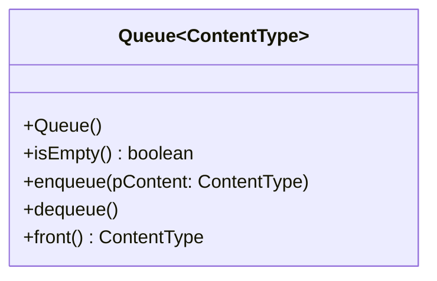

# Einstieg: Wer zuerst kommt

Stell dir vor, du stehst an der Supermarktkasse. Die Regel ist klar: **Wer zuerst da war, ist zuerst an der Reihe.** Du stellst dich hinten an, und die Kassiererin bedient die Person vorne. Niemand kann sich einfach in die Mitte drängeln – das wäre unfair und würde das System durcheinanderbringen. Genau dieses Prinzip steckt hinter der **Warteschlange** in der Informatik.

Doch Warteschlangen sind nicht nur im Alltag wichtig. Sie spielen auch eine zentrale Rolle in vielen technischen Systemen:

- **Druckaufträge:** Wenn mehrere Personen gleichzeitig etwas ausdrucken, werden die Aufträge in einer Warteschlange abgearbeitet.
- **Netzwerkpakete:** Datenpakete, die über das Internet versendet werden, müssen in der richtigen Reihenfolge ankommen – auch hier sorgt eine Warteschlange für Ordnung.
- **Serveranfragen:** Ein Webserver bekommt oft hunderte Anfragen pro Sekunde. Diese werden in einer Warteschlange zwischengespeichert und nacheinander bearbeitet.

:::snippet{#beispiel}
**Beispiel aus dem Alltag:**
Du bist in einem Callcenter. Die Anrufe kommen rein, und die Mitarbeiter:innen nehmen sie in der Reihenfolge entgegen, in der sie eingehen. Wer zuerst anruft, wird zuerst bedient. Das ist eine klassische Warteschlange!

**Beispiel aus der Technik:**
Ein 3D-Drucker bekommt mehrere Druckaufträge. Der Drucker arbeitet sie nacheinander ab – der erste Auftrag, der eingeht, wird auch zuerst gedruckt.
:::

Genau diese Regel – und genau diese Beschränkung – ist die **Warteschlange**.

:::snippet{#definition}
Eine **Warteschlange** (englisch *queue*) ist eine lineare Datenstruktur mit zwei Zugriffsstellen:

- **hinten** wird eingefügt (`enqueue`),
- **vorne** wird gelesen (`front`) und entfernt (`dequeue`).

Das Prinzip heißt **FIFO** – *First In, First Out*: Was zuerst hineinkommt, kommt zuerst wieder heraus.
:::

:::snippet{#merken}
Dass du **nicht** in die Mitte greifen kann, ist kein Mangel, sondern der Zweck. Eine Struktur, die nur zwei Operationen zulässt, kannst du nicht falsch bedienen – und sie lässt sich so bauen, dass beide Operationen **gleich schnell** sind, egal wie lang die Schlange ist.

Wo dir das begegnet: Druckaufträge, eingehende Netzwerkpakete, Tastatureingaben, Aufgaben in einer Warteliste.
:::

Von außen zeigt die Abiturklasse `Queue` nur diese Methoden. Wie sie innen aufgebaut ist, spielt für das Benutzen keine Rolle.

## Erst einmal ausprobieren

Unten liegt eine Operationsfolge bereit. Sage **zuerst** voraus, welche Ausgaben sie erzeugt, und lass sie dann ablaufen.

<oop-stapel-schlange id="schlange-spielwiese" modus="schlange" folge='enqueue("Anna"); enqueue("Ben"); front(); dequeue(); enqueue("Cem"); front(); dequeue(); dequeue(); isEmpty()'></oop-stapel-schlange>

:::snippet{#aufgabe}
a) Notiere die erwarteten Ausgaben, trage sie ein und lass die Folge ablaufen.

b) Nur `front()` und `isEmpty()` liefern überhaupt etwas. Erkläre, warum `dequeue()` keinen Rückgabewert braucht. Wie kommst du an das Element, das entfernt wird?

c) Reihe danach von Hand drei Namen ein und nimm sie wieder heraus. In welcher Reihenfolge kommen sie heraus?
:::

:::snippet{#brain}
**Weiterdenken:** Die Schlange hat keine Methode, die sagt, wie viele Elemente in ihr stehen. Wie könntest du es trotzdem ermitteln – nur mit `enqueue`, `dequeue`, `front` und `isEmpty`? Welchen Zustand hat die Schlange danach?
:::

::::protect{password="java-q-4-ws-e-1" description="Auflösung. Erfrage das Passwort bei deiner Lehrkraft."}

a) `front()` liefert **Anna**, das zweite `front()` liefert **Ben**, `isEmpty()` liefert am Ende **true**. Cem wurde zwar nach Ben eingereiht, steht aber hinter ihm – und wird vom letzten `dequeue()` entfernt.

b) Wer das vorderste Element braucht, holt es sich **vorher** mit `front()` und entfernt es danach mit `dequeue()`. Die Abiturklasse trennt das Nachsehen vom Entfernen.

c) In derselben Reihenfolge, in der sie hineingekommen sind – FIFO.

**Weiterdenken:** Du nimmst so lange vorne heraus, bis die Schlange leer ist, und zählst dabei mit. Danach ist die Schlange allerdings **leer** – die Elemente gehen verloren. Wie man zählt, ohne die Schlange zu zerstören, ist Thema der Seite [Mit der Schlange arbeiten](./handhabung).

::::

## Wer kommt als Nächstes dran?

:::snippet{#aufgabe}
Entscheide jeweils, ob eine Warteschlange passt. Begründe mit dem FIFO-Prinzip.

a) Ein Drucker im Schulnetz bekommt Aufträge von mehreren Rechnern.

b) Ein Textprogramm soll die letzte Änderung rückgängig machen.

c) Eine Arztpraxis ruft Patientinnen und Patienten in der Reihenfolge ihrer Ankunft auf.

d) Ein Server bekommt mehr Anfragen, als er gleichzeitig beantworten kann.
:::

:::snippet{#brain}
**Weiterdenken:** In der Notaufnahme wird nicht nach Ankunft, sondern nach Dringlichkeit behandelt. Wie könnte man das mit **mehreren** Warteschlangen lösen?
:::

::::protect{password="java-q-4-ws-e-2" description="Auflösung. Erfrage das Passwort bei deiner Lehrkraft."}

a) **Passt.** Wer zuerst druckt, bekommt zuerst sein Blatt.

b) **Passt nicht.** Rückgängig nimmt die **zuletzt** gemachte Änderung zurück – das Gegenteil von FIFO. Die passende Struktur lernst du beim [Stapel](../stapel) kennen.

c) **Passt.** Das ist die Supermarktkasse in einer anderen Umgebung.

d) **Passt.** Die Anfragen warten in einer Schlange und werden der Reihe nach abgearbeitet, sobald der Server frei ist.

**Weiterdenken:** Du legst eine Schlange **pro Dringlichkeitsstufe** an. Behandelt wird immer aus der dringendsten Schlange, die nicht leer ist. Innerhalb einer Stufe gilt weiter: Wer zuerst kam, ist zuerst an der Reihe.

::::

<!-- KLP QPh, Daten und ihre Strukturierung: lineare dynamische Datenstrukturen (Schlange);
     "erläutern Operationen dynamischer Datenstrukturen (A)". -->

---

## Selbsttest

::::multievent

**1. In welcher Reihenfolge verlässt man eine Schlange?**

{r1{!wer zuerst kam, geht zuerst}}

{r1{wer zuletzt kam, geht zuerst}}

{r1{in zufälliger Reihenfolge}}

{h{Wie an der Supermarktkasse.}}
{H{Richtig! Man nennt das auch First In, First Out.}}

**2. An welchen Stellen wird bei einer Schlange gearbeitet?**

{r2{nur vorne}}

{r2{!hinten eingefügt, vorne entfernt}}

{r2{nur hinten}}

{h{Neue stellen sich hinten an, bedient wird vorne.}}
{H{Richtig!}}

**3. Wo begegnet dir eine Schlange im Rechner?** (Mehrfachauswahl)

{c1{!bei Druckaufträgen}}

{c1{!bei Nachrichten, die der Reihe nach abgearbeitet werden}}

{c1{!bei Anfragen an einen Server}}

{c1{bei der Rückgängig-Funktion}}

{h{Rückgängig nimmt die zuletzt gemachte Änderung zurück.}}
{H{Richtig! Das ist ein Stapel, keine Schlange.}}

**4. Auf eine leere Schlange kommen A, B und C. Was liefert danach front?**

{r3{!A}}

{r3{B}}

{r3{C}}

{h{Wer zuerst kam, steht vorne.}}
{H{Richtig!}}

::::
